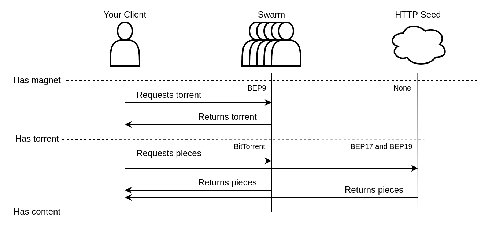
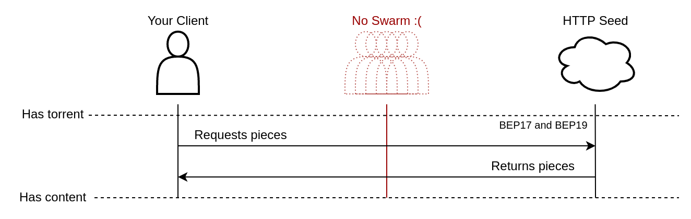
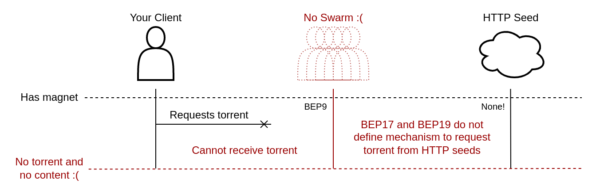
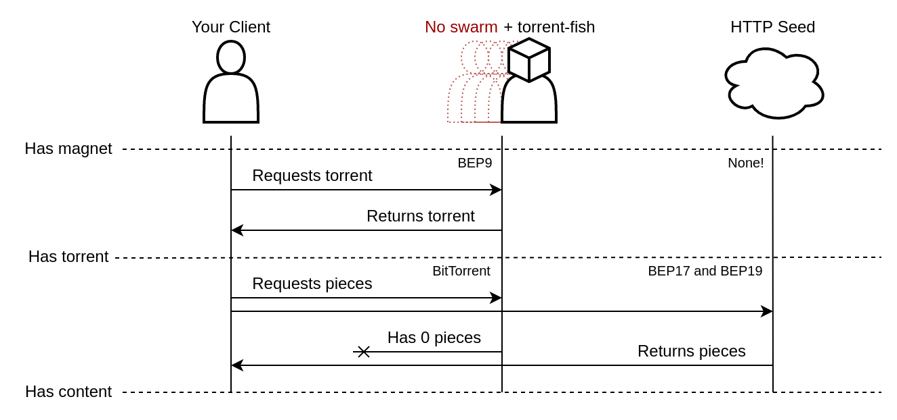

# torrent-fish

[](https://github.com/tweedge/torrent-fish)
[](https://hub.docker.com/repository/docker/tweedge/torrent-fish)
[](https://chris.partridge.tech)
[](https://bsky.app/profile/tweedge.net)
[](https://cybersecurity.theater/@tweedge)

torrent-fish is a *metadata-only* BitTorrent peer built with libtorrent. It's designed to help keep magnet links which rely on [HTTP Seeding](https://wiki.vuze.com/w/HTTP_Seeding) healthy, without the overhead of running other peers or seeds.

Ok, you might think - but what's the point of a metadata-only peer?

### The Gap Between Magnets and HTTP Seeding

What? No way. You might have even used a magnet with an HTTP Seed before! Everything worked fine, right?

#### Scenario 1: Active Swarm + HTTP Seeds: Works!

A normal swarm with HTTP Seeds works well! It's economic, and helps diversify the content sources, and if the swam is healthy enough the HTTP Seed could even deactivate to save bandwidth. You can use a torrent or a magnet to start the download, and everything should work to get you that file quickly.

In the diagram below, make a quick note of the division between the original BitTorrent protocol and the two extensions providing functionality in this situation.



#### Scenario 2: No Swarm + HTTP Seeds + You Get a Torrent: Works!

If you do manage to get the torrent metadata (by starting with the torrent), you can download the entire torrent's contents from the HTTP Seed, even with nobody else in the swarm. The torrent file tells your client exactly which files and byte ranges to request from the HTTP Seed, so it can serve the content directly.



#### Scenario 3: No Swarm + HTTP Seeds + You Get a Magnet: *Doesn't work!*

Now, the gap you might have seen in the above diagrams is very real: while the magnet specification ([BEP9](https://www.bittorrent.org/beps/bep_0009.html)) provides a mechanism for peers to retrieve a torrent's metadata from other peers, *neither it nor either HTTP Seeding extension ([BEP17](https://www.bittorrent.org/beps/bep_0017.html) and [BEP19](https://www.bittorrent.org/beps/bep_0019.html)) provide a mechanism to fetch the torrent metadata from the HTTP Seeds.*

So if client has a magnet and nobody is in the swarm to provision them with a copy of the torrent, they can't fetch any content and will stall. *This is very bad!*



*Note that magnets can include HTTP Seeds, but the inclusion of an HTTP Seed does **not** provide sufficient information for the torrent client to fetch the torrent metadata itself, and therefore the filenames/byte-ranges to request from that HTTP Seed are unknown to the client. This is why the download will stall if there are no peers or seeds in the swarm.*

#### Scenario 4: No Swarm + HTTP Seeds + You Get a Magnet + The Uploader Used torrent-fish: Everything is fixed!

So, torrent-fish provides a solution to scenario 3. If the swarm is reasonably expected to be empty *at least sometimes*, torrent-fish is a lightweight script which performs the only essential task of a peer in that swarm: provisioning new peers with torrent metadata. After the torrent metadata has been provisioned to the new peer, the peer can use the HTTP Seed(s) to retrieve the content itself.

torrent-fish intentionally does not download any pieces of the torrent, so it can maintain as small a footprint as possible - it ensures the *health* of HTTP Seeded torrents, not availability or speed. Because of this narrow focus, torrent-fish is cheap, easy, and reliable - in certain situations, it should even be *much* cheaper than running a full-time seed in a usual torrent client.



### Torrenting for Archivists

So, this seems... niche. In what situations is torrent-fish even relevant?

Well, BitTorrent is fantastically thrifty for large groups of people looking to share specific files online, with each contributing their own bandwidth and resources to provide the files to each other person who is requesting those files. The original uploader does not even bear exclusive (or even the majority) cost for distributing files, and popular torrents can live for years after the original uploader stopped seeding their own file.

That doesn't mean that BitTorrent is the economic choice for all situations, though. BitTorrent expects clients in swarms simultaneously to exchange files - as such, it's rarely a choice for archival storage. A seeder looking at the long term needs to be online all the time, with reasonable frequency (if permitted for their torrent's availability needs), or have some mechanism of determining when it needs to be woken up. These options are pricy, inconvenient, or both.

One way to address this is by using GetRight-style HTTP Seeding, which instructs torrent clients to treat certain HTTP or FTP sources as seeds for a given torrent. That way, no dedicated system is needed to serve the content of a torrent - especially if the HTTP Seed is using now-commodity object storage or a CDN - which can lower cost *in certain situations* compared to even the cheapest virtual machine serving the torrent 24/7.

*An aside: this is [how the Internet Archive distributes data via torrents](https://help.archive.org/help/archive-bittorrents/), they specifically use torrents + HTTP Seeds for the above reasons. A torrent file is provided for for downloads, which allows HTTP Seeds to be utilized, plus anyone else in the swarm can donate bandwidth to help distribute content. The Internet Archive does not provide magnets, as those cannot be converted to torrents without running a torrent client, which is expensive.*

But, torrents are not the best option for every situation - magnet links are much smaller and can be posted wherever text input is allowed, so they show up on many more websites than torrents do. For the rogue archivist, or for people passing data around on social websites (ex. social media, forums, etc.), magnets may be competitively convenient.

So, torrent-fish is certainly niche, but not useless.

### Usage

Generally, to get started with torrent-fish you should make a directory of torrents that need to have their metadata served. Providing torrent-fish with that directory plus the default options should work in the vast majority of cases:

```
% cargo run --release -- -l <directory_with_torrents>
```

or, using the published container:

```
% docker run --rm -p 6881:6881 -v /path/to/torrents:/opt -it tweedge/torrent-fish:latest
```

However, the current list of available options is available with the --help flag:

```
% torrent-fish --help
Usage: torrent-fish [options]

Options:
  -h, --help            show this help message and exit
  -p PORT, --port=PORT  set listening port
  -i LISTEN_INTERFACE, --listen-interface=LISTEN_INTERFACE
                        set interface for incoming connections
  -o OUTGOING_INTERFACE, --outgoing-interface=OUTGOING_INTERFACE
                        set interface for outgoing connections
  -d MAX_DOWNLOAD_RATE, --max-download-rate=MAX_DOWNLOAD_RATE
                        the maximum download rate given in kB/s. 0 means
                        infinite.
  -u MAX_UPLOAD_RATE, --max-upload-rate=MAX_UPLOAD_RATE
                        the maximum upload rate given in kB/s. 0 means
                        infinite.
  -c CONNECTIONS_LIMIT, --connections_limit=CONNECTIONS_LIMIT
                        the global limit on the number of connections opened.
  -l LOAD_PATH, --load-path=LOAD_PATH
                        the path to load torrent files from.
  -s SAVE_PATH, --save-path=SAVE_PATH
                        must be a valid folder BUT won't be used to download
                        anything.
  -r PROXY_HOST, --proxy-host=PROXY_HOST
                        sets HTTP proxy host and port (separated by ':')
```

#### Efficiency

torrent-fish is written in Rust. The release binary is roughly half a megabyte and, because the Rust standard library is statically linked, it has almost no runtime dependencies of its own (libtorrent and the C++ runtime are the only shared libraries). The `Dockerfile` produces a [distroless](https://github.com/GoogleContainerTools/distroless) image as a non-root user, so the runtime image contains only the binary and the libtorrent/C++ runtime it needs - no shell, package manager, or build toolchain. Distroless images keep the image small, give attackers far fewer tools to work with if they get in, and cut the noise from dependency scanners down to just what your application actually uses - see [this write-up on converting Python apps to distroless](https://chris.partridge.tech/2024/distroless-python-in-minutes/) for the details and tradeoffs. In CI this distroless image measures **about 16 MB** with **11 packages** and an idle RSS of **~3 MB**. A `Dockerfile.scratch` variant aims for a fully static musl binary in a `FROM scratch` image (just the binary plus a CA bundle); statically linking libtorrent's C++/OpenSSL stack against musl is intricate, so it is built and validated in CI as an experimental target rather than shipped as `latest`.

`ci.yml` builds and tests the binary and proves the core invariant end-to-end (a magnet-only peer receives metadata while the peer downloads **zero payload bytes**). `measure.yml` builds the container variants and reports their size, dependency count (via Syft), and runtime memory usage on every change, so the efficiency claims stay honest over time. When run in a [Firecracker microVM](https://firecracker-microvm.github.io/) on [Fly](https://fly.io/), the entire torrent-fish instance consumes only a few MB of RAM and several KB/s of bandwidth. This fits easily into Fly's smallest current offering - 1 core, 256MB RAM - *and* customers currently get three of those instances free-forever (as of May 2022).

#### Under the Hood

[libtorrent](https://www.libtorrent.org/) is a popular library that implements BitTorrent - you might use a BitTorrent client that also uses libtorrent, such as [Deluge](https://deluge-torrent.org/) or [qBittorrent](https://www.qbittorrent.org/). torrent-fish is a small Rust program that talks to libtorrent through a thin [CXX](https://cxx.rs/) bridge (`shim/`), applying a few simple settings to every torrent:

* Each piece's priority is set to 0 (do not download)
* `upload_mode` flag is enabled, so torrents are active but not downloading data
* `auto_managed` flag is disabled, so torrents should not enter a downloading state automatically

It should be possible to accomplish the desired results by using *either* setting the piece priorities *or* mucking about with the flags for each torrent, but I occasionally ran into issues where libtorrent would begin to request pieces (BitTorrent is supposed to download missing/corrupt pieces, after all!) and doing both doesn't seem to cause any problems.

This project started life as a Python script (a fork of François M.'s [retrieve.py](https://gist.github.com/francoism90/4db9efa5af546d831ca47208e58f3364), due to his clean usage of libtorrent's bindings) and was later ported to Rust for a smaller runtime footprint and memory use while keeping the same behavior. Rust was chosen over a pure-Rust BitTorrent implementation (e.g. rqbit) specifically to keep libtorrent's maturity and stability. The existing Rust libtorrent binding crates were either abandoned or missing the APIs torrent-fish needs (loading a `.torrent` file, per-piece priorities, and the upload/auto-manage flags), so the CXX bridge here exposes exactly that small surface.
